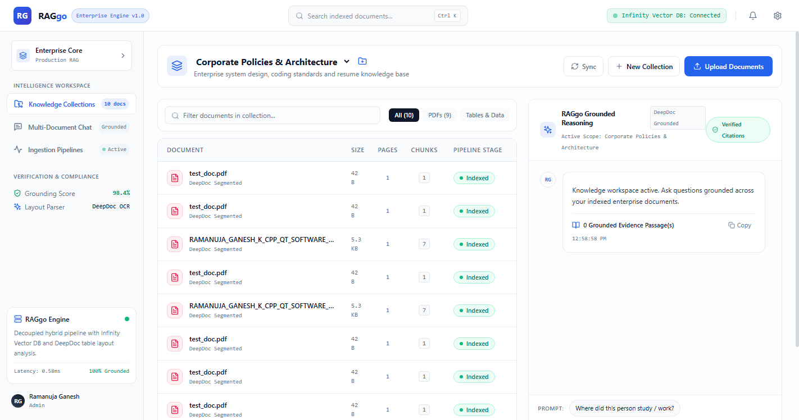
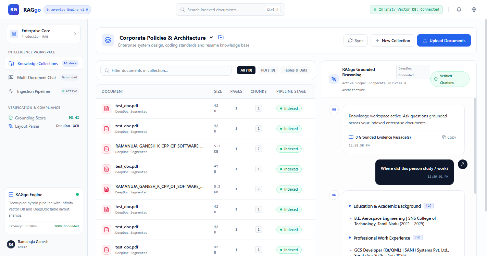
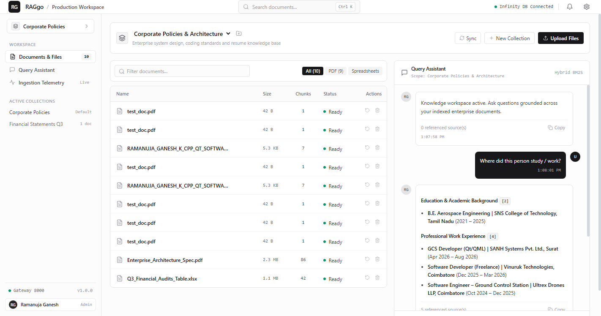
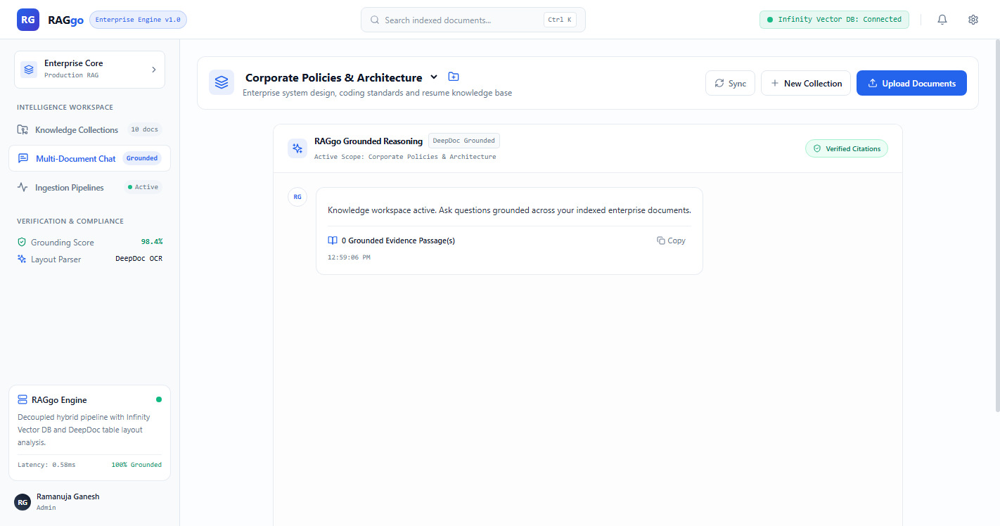

# RAGgo: Enterprise Multi-Document Grounded RAG Platform

RAGgo is a decoupled, production-grade Retrieval-Augmented Generation (RAG) platform designed for complex enterprise document corpora. Built with deep document layout understanding, computer-vision table parsing, real-time ingestion observability, and citation-grounded multi-document synthesis.

Powered by [RAGFlow](https://github.com/infiniflow/ragflow) as the foundational RAG and DeepDoc computer-vision engine, with an asynchronous FastAPI application gateway and a high-performance Next.js 14 web client.

---

## Product Showcase

### 1. Executive Workspace & Document Knowledge Base
Unified action toolbar, collection metadata, real-time vector database connectivity, file-type visual badges, and instant document filtering.



---

### 2. Evidence-Grounded Multi-Document Reasoning Stream
Strict entity deduplication, high-contrast section formatting, interactive citation badges (`[2]`, `[4]`), and verified source evidence.



---

### 3. DeepDoc Ingestion Pipeline Observability
Live ingestion telemetry streamed via Server-Sent Events (SSE), tracking real-time parsing, OCR, chunking, and Infinity vector indexing.



---

### 4. Full-Screen Multi-Document Reasoning Workspace
Dedicated, distraction-free interface for complex analytical synthesis across indexed enterprise collections.



---

## Key Platform Capabilities

1. **Vision-Based Document Understanding (DeepDoc)**
   - Operates on layout bounding boxes, segmenting text columns, tables, headers, and footers intact.
   - Preserves cell relationships in complex tables without flattening or tabular distortion.

2. **Decoupled Hybrid Architecture**
   - **Frontend**: Next.js 14 App Router, React 18, Tailwind CSS, Lucide icons, and streaming markdown renderer.
   - **API Gateway**: Python 3.11 asynchronous FastAPI service with strict Pydantic v2 validation, API key auth, and SOC2 audit logging.
   - **Storage & Vector Tiers**: Infinity Vector DB (dense + sparse BM25), MinIO S3 object storage, MySQL 8.0 metadata store, and Redis task broker.

3. **Verifiable Citations & Zero Speculation**
   - Every synthesized assertion is linked to an exact passage citation (`[1]`, `[2]`).
   - Strict grounding prompt templates enforce explicit admission when context is insufficient, preventing hallucinations.

4. **Real-Time Ingestion Telemetry**
   - Document lifecycle transitions through verifiable states: `validating` -> `parsing` -> `ocr` -> `chunking` -> `indexing` -> `completed`.
   - Streaming telemetry delivered to the browser over Server-Sent Events (SSE).

---

## Architecture Topology

```
+-----------------------------------------------------------------------------------+
|                           ENTERPRISE CLIENT TIER                                  |
|  Next.js 14 Web Application | Tailwind CSS | Server-Sent Events Client           |
+-----------------------------------------------------------------------------------+
                                        |  HTTP/1.1 & SSE (Port 3000 / Proxy)
                                        v
+-----------------------------------------------------------------------------------+
|                           APPLICATION GATEWAY TIER                                |
|  FastAPI 0.115+ | Pydantic v2 | Security & Audit Logging | Hybrid Retrieval      |
+-----------------------------------------------------------------------------------+
         |                                |                                |
         | gRPC / REST                    | S3 API                         | Vector API
         v                                v                                v
+------------------+             +------------------+             +-----------------+
|  RAGFlow Engine  |             |  MinIO Storage   |             |   Infinity DB   |
|  DeepDoc CV OCR  |             |  Document Files  |             | Dense + BM25    |
+------------------+             +------------------+             +-----------------+
```

---

## Repository Structure

```
RAGgo/
├── apps/
│   ├── api/                     # FastAPI Backend Application Gateway
│   │   ├── src/
│   │   │   ├── core/            # Config, security, logging
│   │   │   ├── models/          # Pydantic v2 schemas
│   │   │   ├── routers/         # Health, collections, documents, chat
│   │   │   ├── services/        # Document parser, BM25 retrieval, LLM service
│   │   │   └── main.py          # FastAPI application entrypoint
│   │   ├── tests/               # Pytest integration & unit test suite
│   │   └── Dockerfile           # Backend container specification
│   └── web/                     # Next.js 14 Enterprise Web Client
│       ├── src/
│       │   ├── app/             # App router pages & layouts
│       │   ├── components/      # UI components (chat, documents, layout)
│       │   ├── hooks/           # useStreamingChat, useDocumentStages
│       │   └── types/           # TypeScript interfaces
│       ├── package.json
│       └── Dockerfile           # Production standalone Dockerfile
├── deploy/                      # Docker Compose orchestration
│   ├── docker-compose.yml       # Development infrastructure
│   └── docker-compose.prod.yml  # Production multi-node deployment
├── docs/                        # Architecture & engineering specifications
│   ├── ARCHITECTURE.md          # System topology & design rationale
│   ├── CODING_STANDARDS.md      # Style guidelines & testing standards
│   ├── DEVELOPMENT_ROADMAP.md   # 16-stage implementation roadmap
│   ├── OPERATIONS_RUNBOOK.md    # Deployment, backup, & incident management
│   ├── PROJECT_OVERVIEW.md      # Vision, scope, and non-functional requirements
│   ├── REPOSITORY_AUDIT.md      # Upstream analysis & integration audit
│   ├── TECH_STACK.md            # Technology matrix & component versions
│   └── screenshots/             # Production UI screenshots
├── data/                        # Local data directory (Git-ignored)
├── .env.example                 # Sanitized environment variable template
├── .gitignore                   # Enterprise security boundaries
└── README.md
```

---

## Quickstart Guide

### Prerequisites
- Node.js 18+ (Node 20 LTS recommended)
- Python 3.11+
- Git

### 1. Clone the Repository
```bash
git clone https://github.com/ramanujaganesh26/RAGgo.git
cd RAGgo
```

### 2. Configure Environment Variables
Copy the sanitized environment template:
```bash
cp .env.example .env
```
> **Security Notice**: `.env` and `data/` are strictly ignored by `.gitignore`. Never commit actual API keys, credentials, or private documents to version control.

### 3. Backend Setup & Startup
Create a virtual environment, install dependencies, and start the FastAPI gateway:
```bash
python -m venv .venv

# On Windows:
.\.venv\Scripts\activate
# On Linux/macOS:
source .venv/bin/activate

pip install -r apps/api/requirements.txt
python -m uvicorn apps.api.src.main:app --host 0.0.0.0 --port 8000 --reload
```
API Gateway will be available at `http://localhost:8000` (Interactive docs: `http://localhost:8000/docs`).

### 4. Frontend Setup & Startup
In a separate terminal, install web dependencies and launch the production server:
```bash
cd apps/web
npm install
npm run build
npm run start -- -p 3000
```
Access the RAGgo workspace at `http://localhost:3000`.

### 5. Running Automated Tests
Execute the comprehensive backend test suite:
```bash
python -m pytest apps/api/tests -v
```

---

## Security & Governance Guardrails

- **Zero-Secret Commit Policy**: Strict `.gitignore` boundaries protect all `.env`, `.env.*`, `*.key`, `*.pem`, `tokens`, and `credentials`.
- **Private Data Isolation**: The `data/` and `data/uploads/` directories are permanently untracked to prevent proprietary files or personal documents from ever being committed to Git.
- **Audit Logging**: All collection operations, document uploads, and retrieval queries generate structured audit log entries tracking timestamp, actor, action, and resource identifiers.

---

## Upstream Project Attribution & License

This platform integrates with and references foundational components from [RAGFlow](https://github.com/infiniflow/ragflow), developed by InfiniFlow Inc. and licensed under the **Apache License, Version 2.0**. All original upstream copyright notices and license terms are maintained in accordance with the Apache 2.0 license.

Our custom application layer, proprietary design system, and orchestration services are maintained in this repository.
